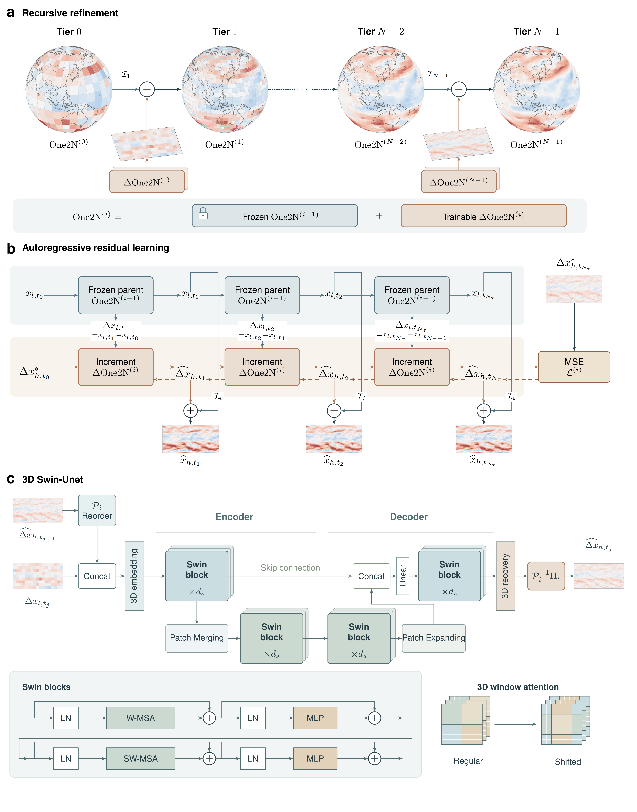
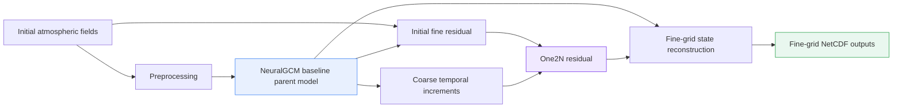

<div align="center">

# One2N

**Recursive refinement extends AI weather forecasting to kilometre scales**

[](environment.yml)
[](https://pytorch.org/)
[](https://docs.jax.dev/)
[](LICENSE)
[](https://arxiv.org/abs/2611.12249)

[Overview](#overview) · [Structure](#project-structure) · [Installation](#installation) · [Demo](#random-data-demonstration) · [Inference](#real-data-inference) · [Data](docs/data.md) · [Reproducibility](docs/reproducibility.md)

</div>

## Overview

This repository provides the preprocessing and inference implementation associated with [**One2N: Recursive refinement breaks the resolution barrier for Earth-system AI**](https://arxiv.org/abs/2611.12249). One2N evolves a fine-grid residual along the trajectory of a frozen coarse-resolution parent model. At each step, the predicted residual is added to the remapped parent state to reconstruct the fine-grid forecast. The residual can represent both spatial refinement and correction of parent-model errors. 

The release includes **inference, configuration, executable random-data examples, and tests**. Training and manuscript evaluation scripts are outside its scope. 






### Key features

- **Configuration-driven execution:** YAML controls paths, model dimensions, coupling/output intervals, seeds, normalization settings, and execution schedule.
- **Two schedules:** generate the baseline first (`batch`), or request one baseline update and immediately apply One2N (`streaming`).
- **Explicit modules:** input readers, remapping, upstream integration, residual recurrence, and output serialization have separate responsibilities.
- **Executable example:** the root-level [`demo.py`](demo.py) runs the complete small-data pipeline in both schedules and compares their results.
- **Numerical regression:** a frozen synthetic reference from the original model accompanies unit and integration tests.

## Project structure

```text
one2n-release/
├── demo.py                      # Visible random-data demonstration entry point
├── predict.py                   # Real-data inference entry point
├── environment.yml              # Conda CPU environment specification
├── configs/
│   ├── inference.yaml           # Reference architecture and forecast settings
│   └── demo.yaml                # Small synthetic example settings
├── src/one2n_inference/
│   ├── cli.py                   # Console commands
│   ├── config.py                # YAML loading, validation, and path resolution
│   ├── constants.py             # Canonical variable order
│   ├── models/                  # Swin-UNet and strict checkpoint loading
│   ├── data/                    # Readers, statistics, and remapping
│   ├── neuralgcm/               # Continuous baseline state and isolated worker
│   ├── inference/               # Packing, residual updates, reconstruction, and pipeline
│   └── demo.py                  # Implementation called by the root demo entry point
├── tests/                       # Unit, regression, and random-data integration tests
├── docs/                        # Data contract, architecture, and reproducibility
├── .github/workflows/ci.yml      # CPU checks on Ubuntu and Windows
├── setup.py                     # Python package installation metadata
├── requirements.txt             # One2N dependency versions
├── requirements-neuralgcm.txt    # Baseline and remapping dependency versions
└── LICENSE                      # MIT license and upstream notice
```

## Installation

Use **Python 3.12**. PyTorch executes One2N; JAX, NeuralGCM, and Dinosaur provide the baseline and conservative remapping. Dependency versions are recorded in [`requirements.txt`](requirements.txt) and [`requirements-neuralgcm.txt`](requirements-neuralgcm.txt). [`setup.py`](setup.py) supplies the Python installation metadata. **Edit YAML in `configs/` for run settings and `environment.yml` for the Conda environment**.

From the repository root, either create the CPU environment:

```bash
conda env create -f environment.yml
conda activate one2n
```

or install into an existing Python 3.12 virtual environment:

```bash
python -m pip install --upgrade pip
python -m pip install torch==2.6.0 torchvision==0.21.0 --index-url https://download.pytorch.org/whl/cpu
python -m pip install -e ".[neuralgcm]"
```

For GPU builds, follow the official [PyTorch](https://pytorch.org/get-started/locally/) and [JAX](https://docs.jax.dev/en/latest/installation.html) guides while retaining the declared versions. The pinned JAX CUDA 12 extra is `jax[cuda12]==0.4.35`; select `runtime.jax_platform: cuda` in YAML to use it. NeuralGCM uses the legacy `PressureLevelModel` interface. Obtain its pretrained checkpoint separately from the [official project](https://github.com/neuralgcm/neuralgcm) and [documentation](https://neuralgcm.readthedocs.io/en/stable/).

Linux with a suitable GPU is recommended for full-resolution forecasts. The reference float32 input tensor alone (`1 × 505 × 25 × 256 × 512`) occupies approximately **6.16 GiB**, excluding parameters and intermediate activations. The demo runs on CPU. In streaming mode the baseline worker remains alive during One2N inference, so a shared GPU must hold both components; CPU JAX is the supplied default. Output remapping uses CPU JAX.

## Random-data demonstration

The root entry point is [`demo.py`](demo.py), and its implementation is [`src/one2n_inference/demo.py`](src/one2n_inference/demo.py). Both commands below call that implementation:

```bash
python demo.py --config configs/demo.yaml --output demo_output
```

```bash
one2n demo --config configs/demo.yaml --output demo_output
```

The demo generates small random fields, statistics, and a random Swin-UNet, then exercises the actual pipeline, conservative remapping, residual recurrence, and NetCDF serialization. A controlled synthetic baseline replaces the research NeuralGCM checkpoint. It executes **both schedules** and compares their outputs; it does not measure atmospheric forecast skill.

The demo YAML shares the inference configuration schema. The demo command replaces checkpoint, statistics, and input locations with generated local artifacts; it never opens the real-data NeuralGCM checkpoint path in that profile.

Expected products are:

```text
demo_output/
├── artifacts/                  # Generated random_model.pt and random_stats.pt
├── inputs/initial_pressure.nc  # Generated fine-grid initialization
├── batch/                      # One run directory named by the synthetic initialization
├── streaming/                  # Corresponding streamed run directory
└── summary.json                # Comparison results and demonstration record
```

The dated run directory comes from the single synthetic epoch, `forecast.start_time`, in `configs/demo.yaml`. That timestamp anchors NetCDF time coordinates and test fixtures; it does not prescribe the date of a real forecast. Tests derive their file dates and expected valid times from this setting. The terminal reports checks and elapsed time. No weather downloads or trained research weights are required.


## Real-data inference

### Prepare inputs and edit YAML

Supply the fields and artifacts described in [Data and artifacts](docs/data.md), then edit [`configs/inference.yaml`](configs/inference.yaml). Paths are resolved from `paths.base_dir`, itself relative to the YAML file, independently of the command's working directory.

```yaml
forecast:
  num_timesteps: 96
  input_step_hours: 2
  output_step_hours: 2
  schedule: batch
```

The complete file also contains `paths`, `model`, `data`, `neuralgcm`, and `runtime` settings. It deliberately has no default real initialization date. Supply `--start-time` with a UTC initialization present in your input files, or add your chosen `forecast.start_time` to YAML. Model dimensions must match the checkpoint; changing configuration does not make incompatible weights usable. Experiment-specific values belong in YAML. Tensor indices and constants defining mathematical operations remain in source code.

| Setting | Meaning |
| --- | --- |
| `start_time` / `--start-time` | UTC initialization present in the prepared data; format `YYYYMMDDHH` |
| `num_timesteps` | Baseline states, **including initialization**, as in the original script |
| `input_step_hours` | Coupling interval: one baseline increment and one residual update |
| `output_step_hours` | Saving interval, an integer multiple of the coupling interval |
| `schedule` | `batch` or `streaming` |
| `model.trained_step_hours` | Coupling interval associated with the supplied weights |
| `neuralgcm.rollout_window` | Maximum states per upstream unroll in batch mode |

The input interval must match `model.trained_step_hours`; use a corresponding trained checkpoint for a different interval. Output frequency can change without skipping intermediate residual updates.

### Check and run

In Bash, enter the initialization that matches your prepared files, then check and run:

```bash
read -r -p "UTC initialization (YYYYMMDDHH): " START_TIME
one2n check --config configs/inference.yaml --start-time "$START_TIME"
python predict.py --config configs/inference.yaml --start-time "$START_TIME"
```

If the actual initialization is already set in YAML, the `--start-time` override can be omitted. There is no automatic substitution of the current date or a historical example date.

PowerShell users can set the same argument with `$StartTime = Read-Host "UTC initialization (YYYYMMDDHH)"`, then pass `--start-time $StartTime`.

`check` validates configuration and required input locations; it does not load weather arrays or certify their units. Missing research inputs produce a nonzero exit status until supplied.

For a short streamed run with a different output frequency, reuse the initialization entered above:

```bash
one2n predict --config configs/inference.yaml --start-time "$START_TIME" --schedule streaming --input-step-hours 2 --output-step-hours 6 --num-timesteps 4
```

`python -m one2n_inference` is equivalent to `one2n`. Use `one2n --help` and `one2n predict --help` for all options.

### Execution schedules

| Mode | Order of execution |
| --- | --- |
| `batch` | Generate the full baseline, close its process, then run One2N along the trajectory and save selected outputs. |
| `streaming` | Keep an encoded baseline state in a persistent worker; request its next state, run one residual update, save if due, then request another state. |

Streaming never reinitializes NeuralGCM at each update. Both schedules preserve continuous latent state, persist initialization-time forcing, and update the residual at every coupling interval. Controlled-baseline tests compare their outputs; real NeuralGCM forecast equivalence remains an artifact-dependent validation task.

> With 96 states and a two-hour coupling interval, inference performs 95 One2N updates and reaches 190 hours. The final update is always saved, even between regular output times.

## Data and outputs

**Weather data, One2N weights, normalization statistics, and the NeuralGCM checkpoint are not redistributed here.** Source access, exact file conventions, units, grids, pressure levels, and artifact roles are specified in [Data and artifacts](docs/data.md). 

Runs write to `paths.output/START_TIME/`:

| File | Contents |
| --- | --- |
| `output_neuralgcm_YYYYMMDDHH_N.nc` | Native baseline trajectory, including initialization |
| `output_one2n_YYYYMMDDHH.nc` | Fine forecast at a selected valid time |
| `run_config.json` | Resolved configuration used by the run |

Fine forecasts contain zonal wind, meridional wind, temperature, specific humidity, and geopotential, with dimensions `(time, level, latitude, longitude)`, descending latitude, and source units. Negative specific humidity is clipped only in physical outputs. Existing matching files are replaced.

## Tests and reproducibility

```bash
python -m unittest discover -s tests -v
```

Tests use generated fields, temporary files, and a frozen original-model reference. They cover configuration, parameter compatibility, numerical transforms, tile ordering, baseline state continuity, scheduling, real remapping, and forecast serialization, without downloading research artifacts. GitHub Actions is configured for Ubuntu and Windows CPU checks; hosted status becomes available after upload.

[`tests/fixtures/original_model_reference.npz`](tests/fixtures/original_model_reference.npz) stores a small randomly initialized model state, a generated input, and the expected output produced by the original implementation. It detects numerical regressions when code changes. **Real inference and the random-data demo do not load this file.** It is required by the original-model regression test in the full suite, so it is retained here; removing it also requires updating that test. Fixture provenance is recorded in [`tests/fixtures/README.md`](tests/fixtures/README.md).

Read [Architecture](docs/architecture.md) for the numerical contract and [Reproducibility](docs/reproducibility.md) for validation scope and publication materials.

## License and acknowledgements

Source code is distributed under the [MIT license](LICENSE). Swin components retain the upstream Microsoft notice. The implementation builds on [Swin Transformer](https://github.com/microsoft/Swin-Transformer) and [Swin-Unet](https://github.com/HuCaoFighting/Swin-Unet). [NeuralGCM](https://github.com/neuralgcm/neuralgcm), [Dinosaur](https://github.com/neuralgcm/dinosaur), and their model/data artifacts retain their respective licenses and terms.
